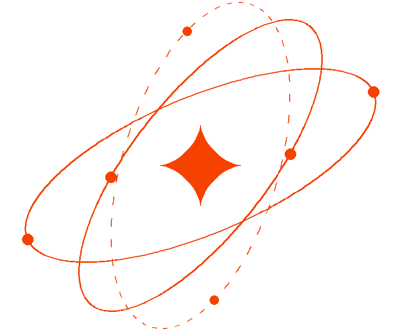
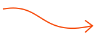
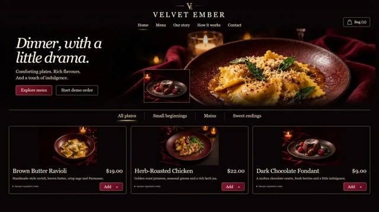
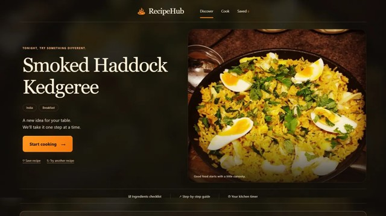
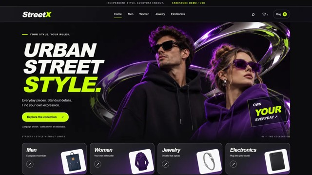
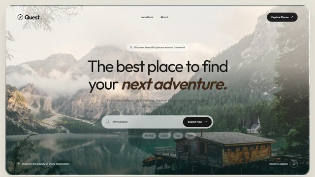

<!-- Custom headings/decorations are images. All body content below is native selectable text. -->

<strong>01 / FLOW STUDIO</strong>

<table width="100%"><tr>
<td width="66%" valign="top">

<strong>R&amp;D &amp; IT Manager at Windbridge Concepts</strong> Ahmedabad, India

I turn everyday business processes into connected, dependable workflows. With a background in operations, product development and IT, I build practical automation and internal systems that bring clarity, accuracy and consistency to day-to-day work.

 <a href="https://raunakvaja.pages.dev/">raunakvaja.pages.dev</a>

</td>
<td width="34%" valign="middle"></td>
</tr></table>

---

<table><tr>
<td></td><td><strong>INTERNAL SYSTEMS</strong></td>
<td></td><td><strong>DJANGO PROJECTS</strong></td>
<td>Design &#8594; R&amp;D &#8594; IT &#8594; <strong>Automation</strong></td>
</tr></table>

<table width="100%">
<tr><td width="43%" valign="top"><h3>01 &nbsp; Production SOT</h3>
Centralizes order intake, tracking and shipment reconciliation in one place.
</td><td width="14%"></td><td width="43%" valign="top"> <h3>02 &nbsp; Invoice Creation System</h3>
Creates shipment-based invoices with validation, review and PDF/Excel generation.
</td></tr>
<tr><td valign="top"><h3>03 &nbsp; Checklist Automation</h3>
Automates checklist validation using defined business rules to reduce manual work.
</td><td></td><td valign="top"> <h3>04 &nbsp; Bill of Entry Checking</h3>
Checks import documents, flags exceptions and helps resolve issues early.
</td></tr>
</table>

Internal source and company data are not public.

---

<strong>DJANGO PROJECTS</strong> &nbsp; &middot; &nbsp; PREVIEWS (NOT LIVE DEMOS)

<table width="100%">
<tr>
<td width="28%"></td><td width="22%" valign="top"><h3>Velvet Ember</h3>
Restaurant demo with menu filters and a session-based bag.
<a href="https://github.com/raunakvaja/Velvet-Ember-Django">Source &amp; screenshots &#8599;</a></td>
<td width="28%"></td><td width="22%" valign="top"><h3>Recipe Explorer</h3>
Fetches recipes from TheMealDB with a detailed cooking view.
<a href="https://github.com/raunakvaja/Recipe-Explorer-Django">Source &amp; screenshots &#8599;</a></td>
</tr>
<tr>
<td width="28%"></td><td width="22%" valign="top"><h3>StreetX Store</h3>
Product catalog using the Fake Store API with caching.
<a href="https://github.com/raunakvaja/StreetX-Store-Django">Source &amp; screenshots &#8599;</a></td>
<td width="28%"></td><td width="22%" valign="top"><h3>Quest Travel</h3>
City search and place details using the Geoapify API.
<a href="https://github.com/raunakvaja/Quest-Travel-Django">Source &amp; screenshots &#8599;</a></td>
</tr>
</table>

Completed learning demonstrations; no commercial payments, orders or bookings.

---

<strong>SKILLS</strong>

<table width="100%"><tr>
<td width="33%" valign="top">
 &nbsp; <strong>Connect &amp; automate</strong>

n8n, REST APIs, Webhooks, JSON, Google Sheets, Telegram
</td>
<td width="33%" valign="top">
 &nbsp; <strong>Deploy &amp; maintain</strong>

Docker, Ubuntu, monitoring, troubleshooting, backup and recovery
</td>
<td width="34%" valign="top">
 &nbsp; <strong>Build &amp; analyse</strong>

Python, Django, NumPy, pandas, Matplotlib, Seaborn
</td>
</tr></table>

 &nbsp; <strong>LEARNING &amp; COURSES</strong>

Completed foundation coursework in Python, Django, NumPy, pandas, Matplotlib and Seaborn. Advanced Full Stack AI at Felix ITs (expected March 2027).

---

I'm open to automation opportunities. Remote or relocation, with a one-month notice.

<a href="https://raunakvaja.pages.dev/">Portfolio &#8599;</a> &nbsp; | &nbsp; <a href="https://www.linkedin.com/in/raunakvaja/">LinkedIn &#8599;</a> &nbsp; | &nbsp; <a href="mailto:raunakvaja@gmail.com">Email &#8599;</a>

