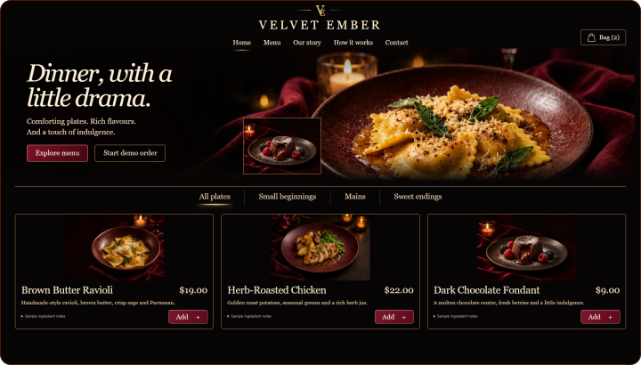
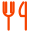
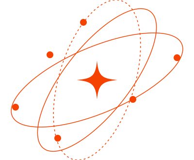

<!-- Flow Studio: native text, orange decorative assets, one animated hero orbit. -->

RAUNAK VAJA &nbsp; / &nbsp; AUTOMATION &amp; INTEGRATIONS

<h1>Make work <em>flow.</em></h1>
<h2>Raunak Vaja</h2>

<strong>R&amp;D &amp; IT Manager</strong> at Windbridge Concepts

 &nbsp; Ahmedabad, India

<strong>Connected, dependable workflows.</strong>

I turn everyday business processes into practical automations and internal tools.

<a href="https://raunakvaja.pages.dev/">Portfolio &#8599;</a> &nbsp; | &nbsp; <a href="https://www.linkedin.com/in/raunakvaja/">LinkedIn &#8599;</a> &nbsp; | &nbsp; <a href="mailto:raunakvaja@gmail.com">Email &#8599;</a>

 

<table width="100%">
<tr>
<td width="23%" align="center"><h1>04</h1><strong>INTERNAL SYSTEMS</strong></td>
<td width="23%" align="center"><h1>04</h1><strong>DJANGO PROJECTS</strong></td>
<td width="54%" align="center">Design &#8594; R&amp;D &#8594; IT &#8594; <strong>Automation</strong></td>
</tr>
</table>

<h2> &nbsp; Behind the scenes. Ahead of the repetition.</h2>

Real operational requirements. <strong>Connected systems.</strong>

<table width="100%">
<tr>
<td width="50%" valign="top"><h3> &nbsp; <code>01</code> Production SOT</h3>
<strong>Order intake</strong>, tracking and shipment reconciliation.

<code>Intake</code> &#8594; <code>Track</code> &#8594; <code>Shipment</code>
</td>
<td width="50%" valign="top"><h3> &nbsp; <code>02</code> Invoice Creation System</h3>
<strong>Shipment data</strong>, validation, review and PDF/Excel outputs.

<code>Shipment</code> &#8594; <code>Review</code> &#8594; <code>Documents</code>
</td>
</tr>
<tr>
<td width="50%" valign="top"><h3> &nbsp; <code>03</code> Checklist Automation</h3>
<strong>Defined business rules</strong> and checklist validation.

<code>Inputs</code> &#8594; <code>Rules</code> &#8594; <code>Validation</code>
</td>
<td width="50%" valign="top"><h3> &nbsp; <code>04</code> Bill of Entry Checking</h3>
<strong>Document checks</strong> and exception alerts.

<code>Document</code> &#8594; <code>Check</code> &#8594; <code>Notify</code>
</td>
</tr>
</table>

<em>Internal source and company data are not public.</em>

<a href="https://raunakvaja.pages.dev/#work"><strong>Read the automation case studies &#8599;</strong></a>

<h2> &nbsp; Built to explore. Made to be seen.</h2>

DJANGO LEARNING PROJECTS &nbsp; / &nbsp; ORIGINAL INTERFACE PREVIEWS

<table width="100%"><tr>
<td width="50%" valign="top"><h3> &nbsp; Velvet Ember</h3>
Menu filters &middot; Session bag &middot; Contact form

<a href="https://github.com/raunakvaja/Velvet-Ember-Django"><strong>Source &amp; screenshots &#8599;</strong></a>
</td>
<td width="50%" valign="top"><h3> &nbsp; Recipe Explorer</h3>
TheMealDB &middot; Ingredients &middot; Cooking view

<a href="https://github.com/raunakvaja/Recipe-Explorer-Django"><strong>Source &amp; screenshots &#8599;</strong></a>
</td>
</tr><tr>
<td width="50%" valign="top"><h3> &nbsp; StreetX Store</h3>
Fake Store API &middot; Catalog &middot; Caching

<a href="https://github.com/raunakvaja/StreetX-Store-Django"><strong>Source &amp; screenshots &#8599;</strong></a>
</td>
<td width="50%" valign="top"><h3> &nbsp; Quest Travel</h3>
Geoapify &middot; City search &middot; Place details

<a href="https://github.com/raunakvaja/Quest-Travel-Django"><strong>Source &amp; screenshots &#8599;</strong></a>
</td>
</tr></table>

Completed learning demonstrations. No commercial payments, orders or bookings.

<a href="https://raunakvaja.pages.dev/#projects"><strong>Explore all project galleries &#8599;</strong></a>

<h2> &nbsp; A practical toolkit.</h2>
<table width="100%"><tr>
<th width="33%"> Connect &amp; automate</th>
<th width="33%"> Deploy &amp; maintain</th>
<th width="34%"> Build &amp; analyse</th>
</tr>
<tr><td><code>n8n</code></td><td><code>Docker</code></td><td><code>Python</code></td></tr>
<tr><td><code>REST APIs</code></td><td><code>Ubuntu</code></td><td><code>Django</code></td></tr>
<tr><td><code>Webhooks</code></td><td><code>Monitoring</code></td><td><code>NumPy</code></td></tr>
<tr><td><code>JSON</code></td><td><code>Troubleshooting</code></td><td><code>pandas</code></td></tr>
<tr><td><code>Google Sheets</code></td><td><code>Backup &amp; recovery</code></td><td><code>Matplotlib</code></td></tr>
<tr><td><code>Telegram</code></td><td>&nbsp;</td><td><code>Seaborn</code></td></tr>
</table>

 &nbsp; <strong>Foundation coursework completed</strong> Python, Django, NumPy, pandas, Matplotlib and Seaborn.

<strong>&#128214; Learning &amp; next steps</strong>

Course: <strong>Advanced Full Stack AI at Felix ITs</strong>. Expected completion: <strong>March 2027</strong>.

Growing next: JavaScript for n8n, resilient API integrations, Git and practical data analysis projects.

<h2>Your next workflow. My next chapter.</h2>

Open to <strong>automation, integration and Python development</strong> opportunities.

<em>Ahmedabad &middot; Remote or relocation &middot; One-month notice</em>

 &nbsp;  &nbsp; 

<a href="https://raunakvaja.pages.dev/">Portfolio</a> &nbsp; | &nbsp; <a href="https://www.linkedin.com/in/raunakvaja/">LinkedIn</a> &nbsp; | &nbsp; <a href="mailto:raunakvaja@gmail.com">raunakvaja@gmail.com</a>

<a href="tel:+918447389219">+91 84473 89219</a> &nbsp; &middot; &nbsp; <a href="https://wa.me/918447389219">WhatsApp &#8599;</a>

 

rv&#10035; <em>Thoughtful automation. Practical execution.</em>

