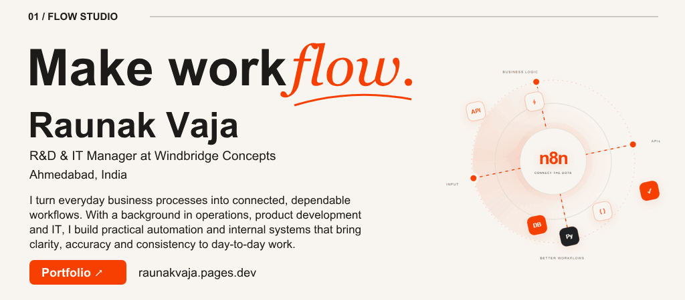
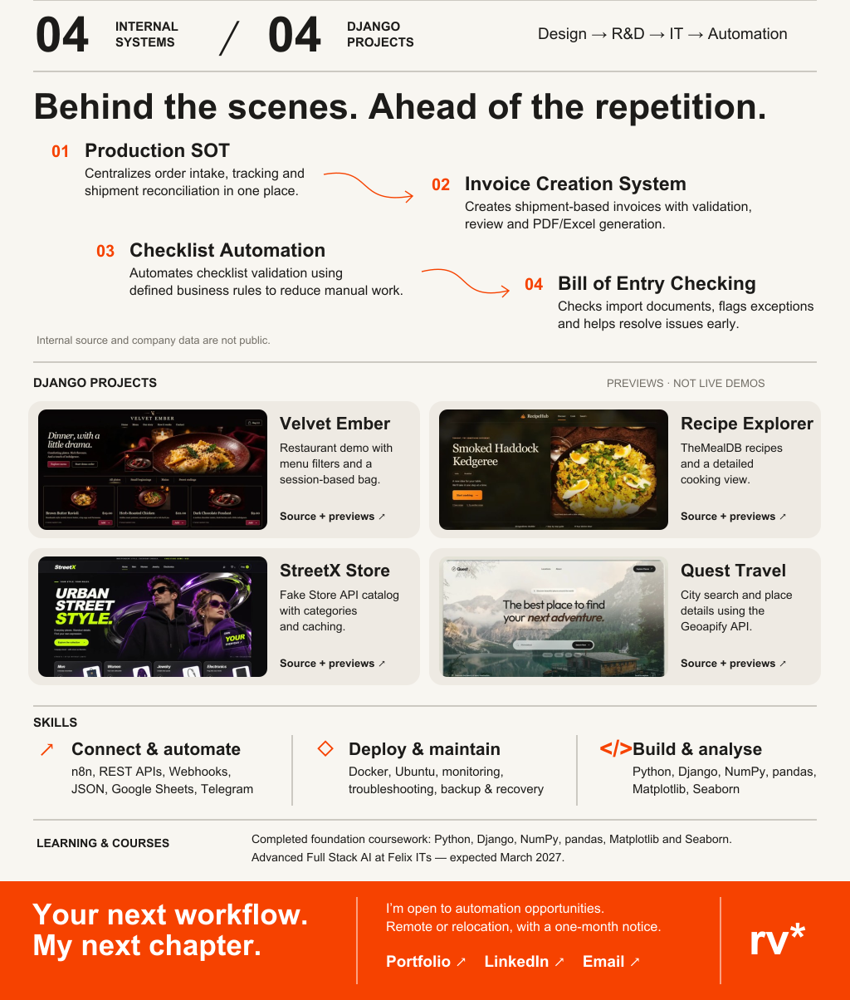

<!-- Upload README.md and the complete flow-assets folder to raunakvaja/raunakvaja. -->

**Explore:** [Portfolio](https://raunakvaja.pages.dev/) · [LinkedIn](https://www.linkedin.com/in/raunakvaja/) · [Email](mailto:raunakvaja@gmail.com)

**Project source & screenshots:** [Velvet Ember](https://github.com/raunakvaja/Velvet-Ember-Django) · [Recipe Explorer](https://github.com/raunakvaja/Recipe-Explorer-Django) · [StreetX Store](https://github.com/raunakvaja/StreetX-Store-Django) · [Quest Travel](https://github.com/raunakvaja/Quest-Travel-Django)

Read the profile as text · accessibility & searchable version

# Raunak Vaja — Make work flow.

R&D & IT Manager at Windbridge Concepts · Ahmedabad, India.

I turn everyday business processes into connected, dependable workflows. With a background in operations, product development and IT, I build practical automation and internal systems that bring clarity, accuracy and consistency to day-to-day work.

**Design → R&D → IT → Automation**

## Behind the scenes. Ahead of the repetition.

| Internal system | What it does |
|---|---|
| Production SOT | Centralizes order intake, production tracking, shipment reconciliation and reporting. |
| Invoice Creation System | Validates shipment and parcel data, supports review, and generates PDF/Excel outputs. |
| Checklist Automation | Applies defined Accounts & Finance checklist rules and validation. |
| Bill of Entry Checking | Checks import documents, flags exceptions and sends correction notifications. |

Internal source and company data are not public. I also work on workflow backups, recovery checks and Telegram notifications. [Automation case studies](https://raunakvaja.pages.dev/#work).

## Four completed Django learning projects

- **Velvet Ember:** Restaurant demo with menu filters, session-based bag and contact form validation.
- **Recipe Explorer:** TheMealDB recipes, ingredients, instructions and a dedicated cooking view.
- **StreetX Store:** Fake Store API product catalog with categories and caching.
- **Quest Travel:** Geoapify city search, nearby attractions and detailed place information.

These are learning demonstrations. Screenshots are previews, not live demos; no commercial payments, orders or bookings.

## Toolkit

- **Connect & automate:** n8n, REST APIs, Webhooks, JSON, Google Sheets, Telegram.
- **Deploy & maintain:** Docker, Ubuntu, monitoring, troubleshooting, workflow backups and recovery.
- **Build & analyse:** Python, Django, NumPy, pandas, Matplotlib, Seaborn.

Completed foundation coursework in Python, Django, NumPy, pandas, Matplotlib and Seaborn. Advanced Full Stack AI at Felix ITs — expected March 2027. Continuing JavaScript for n8n, resilient API integrations, Git and practical data projects.

## Your next workflow. My next chapter.

Open to automation opportunities · Remote or relocation · One-month notice.

[Portfolio](https://raunakvaja.pages.dev/) · [LinkedIn](https://www.linkedin.com/in/raunakvaja/) · [Email](mailto:raunakvaja@gmail.com) · [WhatsApp](https://wa.me/918447389219)

